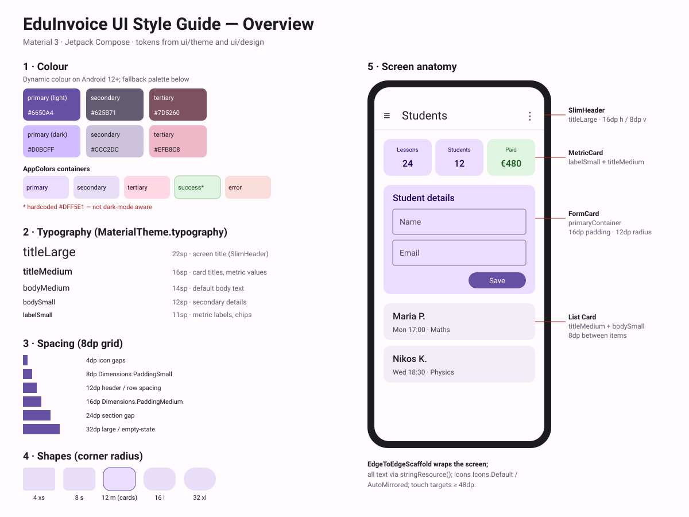

# UI Style Guide

Conventions for the EduInvoice Compose UI, derived from the current code. Tokens live in
`app/src/main/java/gr/eduinvoice/ui/theme` and `ui/design`; shared components in `ui/components`.



## 1. Principles
- Material 3 first: read colours, type and shapes from `MaterialTheme`, never hardcode.
- Reuse `ui/design` building blocks (`SlimHeader`, `FormCard`, `MetricCard`) before writing new ones.
- 8dp spacing grid; `Modifier` is the first optional parameter of every composable.
- Every screen must work in light and dark theme.

## 2. Colour
- `EduInvoiceTheme` uses **dynamic colour** on Android 12+; otherwise the fallback palette
  (`Color.kt`): primary `#6650A4`/`#D0BCFF`, secondary `#625B71`/`#CCC2DC`, tertiary `#7D5260`/`#EFB8C8`
  (light/dark).
- Surfaces for grouped content use container roles via `AppColors`
  (`primaryContainer`, `secondaryContainer`, `tertiaryContainer`, `errorContainer`, `successContainer`).

```kotlin
// Do
Card(colors = CardDefaults.cardColors(containerColor = AppColors.secondaryContainer)) { … }
// Don't
Card(colors = CardDefaults.cardColors(containerColor = Color(0xFFE8DEF8))) { … }
```

## 3. Typography
Use `MaterialTheme.typography` only (`Type.kt` overrides `bodyLarge`: 16sp/24sp, 0.5sp tracking).

| Style | Size | Use |
|---|---|---|
| `titleLarge` | 22sp | Screen title (`SlimHeader`) |
| `headlineSmall` | 24sp | Dialog / empty-state headings |
| `titleMedium` | 16sp | Card titles, list item names, metric values |
| `bodyLarge` | 16sp | Form input, prominent body |
| `bodyMedium` | 14sp | Default body text |
| `bodySmall` | 12sp | Secondary details (dates, subjects) |
| `labelMedium` / `labelSmall` | 12 / 11sp | Chips, metric labels, captions |

## 4. Spacing & Dimensions
Use `Dimensions` where a token exists; otherwise stay on the grid.

| Value | Token | Use |
|---|---|---|
| 4dp | – | Icon-to-text gaps |
| 8dp | `Dimensions.PaddingSmall` | Between list items, vertical header padding |
| 12dp | – | Row `spacedBy` inside headers/cards |
| 16dp | `Dimensions.PaddingMedium` | Screen side padding, card content padding |
| 24dp / 32dp | – | Section gaps, empty-state padding |

## 5. Shapes
`Shape.kt`: extraSmall 4dp · small 8dp · medium 12dp (`Dimensions.CornerRadiusMedium`, cards) ·
large 16dp · extraLarge 32dp. Use `MaterialTheme.shapes.*`, not `RoundedCornerShape(n.dp)`.

## 6. Screen layout
Every screen: `EdgeToEdgeScaffold` + `SlimHeader` (title in `titleLarge`, menu or back icon, trailing
actions), content padded 16dp horizontally.

```kotlin
EdgeToEdgeScaffold(
    topBar = { SlimHeader(title = stringResource(R.string.students), onBack = onBack) }
) { padding ->
    LazyColumn(
        contentPadding = padding,
        modifier = Modifier.padding(horizontal = Dimensions.PaddingMedium),
        verticalArrangement = Arrangement.spacedBy(Dimensions.PaddingSmall)
    ) { … }
}
```

## 7. Components
| Component | Where | Use |
|---|---|---|
| `SlimHeader` | `ui/design` | Top bar for all screens |
| `FormCard` | `ui/design` | Grouped form fields; `primaryContainer`, 16dp padding |
| `MetricCard` | `ui/design` | KPI tile: `labelSmall` label + `titleMedium` value |
| `StudentCard`, `ArchivedStudentCard` | `ui/components` | Student list rows |
| `ModernSearchBar`, `ModernSearchFilterSheet` | `ui/components` | Search and filtering |
| `ClickableReadOnlyField` | `ui/components` | Date/picker-backed fields |
| `MasterActionBox` | `ui/components` | Primary screen actions |
| `LazyLoadingList`, `VirtualScrollingList` | `ui/components` | Large lists (pagination) |

## 8. Icons
- `Icons.Default.*` for general icons; `Icons.AutoMirrored.Filled.*` for directional ones (back arrow, etc.).
- Interactive icons go in `IconButton` (48dp touch target) with a localised `contentDescription`.

## 9. Text & strings
All user-visible text, including `contentDescription`, comes from `strings.xml` via `stringResource()`.

```kotlin
Text(stringResource(R.string.save))   // Do
Text("Save")                          // Don't
```

## 10. States
- Loading: `ModernSkeletonComponents` / `ShimmerEffects`, or `ModernProgressIndicators`.
- Empty: `ModernEmptyStates`.
- Errors: wrap screens in `ErrorBoundary`; show dialogs with `ErrorDialog`; transient messages via `SnackbarBus`.

## 11. Motion & accessibility
- Animations from `ui/animations/ModernAnimations.kt`; keep them short and purposeful.
- Helpers in `ui/accessibility/ModernAccessibility.kt`; touch targets ≥ 48dp; don't convey state by colour alone.

## 12. Known inconsistencies (follow-ups)
1. `AppColors.successContainer` is hardcoded `#DFF5E1` — not dark-mode aware; define light/dark values.
2. `ModernTypography.kt` duplicates the type scale and is effectively unused — remove or adopt.
3. Fallback palette is the default Android Studio template purple — consider a brand palette.
4. ~195 hardcoded `Text("…")` literals vs ~199 `stringResource` calls; `SlimHeader` content descriptions
   are hardcoded.
5. 18 screens use plain `Scaffold` and 1 uses `AppTopBar` instead of `EdgeToEdgeScaffold` + `SlimHeader`.
6. 39 raw `Card(` calls; prefer `FormCard`/`MetricCard` or a shared list-card component.
7. `Dimensions` only defines 3 tokens; add 4/12/24/32dp tokens and replace hardcoded dp values.
